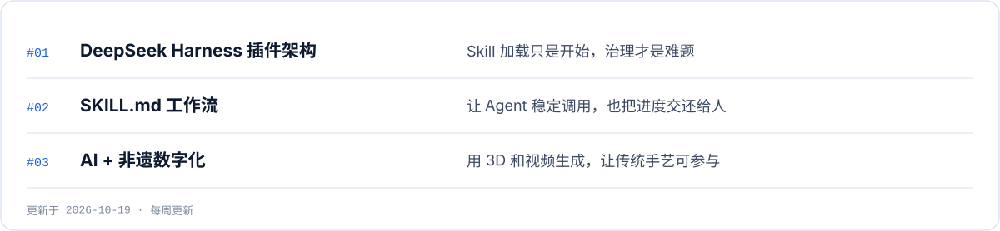

<picture>
  <source media="(prefers-color-scheme: dark)" srcset="./assets/banner-dark.svg" />
  
</picture>

<picture>
  <source media="(prefers-color-scheme: dark)" srcset="./assets/now-dark.svg" />
  
</picture>

  <a href="https://zeroonehub.github.io"><picture><source media="(prefers-color-scheme: dark)" srcset="./assets/pill-site-dark.svg" /></picture></a>
  &nbsp;
  <a href="mailto:j567564345@gmail.com"><picture><source media="(prefers-color-scheme: dark)" srcset="./assets/pill-mail-dark.svg" /></picture></a>

<!--
  维护说明：图片由 scripts/build_assets.py 生成。
  每周更新"最近在研究"：改脚本里的 NOW 和 UPDATED → python3 scripts/build_assets.py → 提交推送。
  姓名和基本信息在 GitHub 左侧边栏，项目由 Pinned repositories 展示，这里都不重复放。
-->
