<picture>
  <source media="(prefers-color-scheme: dark)" srcset="./assets/header-dark.svg" />
  
</picture>

 

### 最近在研究 Now

> **DeepSeek Harness 插件架构**　Skill 加载只是开始，治理才是难题 
> **SKILL.md 工作流**　让 Agent 稳定调用，也把进度交还给人 
> **AI + 非遗数字化**　用 3D 和视频生成，让传统手艺可参与 
> 更新于 2026-10-19 · 每周更新

### 项目 Projects

<table>
  <tr>
    <td width="50%" valign="top">
      <b>AIPM 工坊</b> 
      个人 AI 产品经理工作台，基于 DeepSeek Harness 二次开发 
      Agent · TypeScript · 进行中
    </td>
    <td width="50%" valign="top">
      <b>AIPM Skills</b> 
      产品经理全流程 Skill 合集：总控分派 + 六站立项教练 
      SKILL.md · Workflow · 进行中
    </td>
  </tr>
  <tr>
    <td width="50%" valign="top">
      <b><a href="https://github.com/ZeroOnehub/chengyi">承艺 · 山河入坊</a></b> 
      非遗数字手作交互原型，接入大模型讲解非遗 
      WebGL · Dify Agent · <a href="https://zeroonehub.github.io/chengyi/">在线体验 ↗</a>
    </td>
    <td width="50%" valign="top">
      <b>承艺 3.0</b> 
      可探索、可参与创作的非遗数字世界 
      Three.js · AI 助手 · 陶瓷篇初版
    </td>
  </tr>
</table>

<!-- TODO(樊烨)：发布第一篇文章后加「### 文章 Writing」一节：- [标题](链接) 日期 -->

 

  <a href="https://github.com/ZeroOnehub">GitHub</a>
  <!-- TODO(樊烨)：确认后补上，用「 · 」分隔：个人网站 · 邮箱 · 小红书 · 公众号 · 人人都是产品经理 -->

