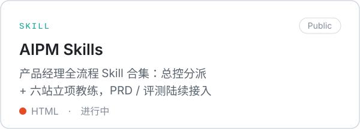
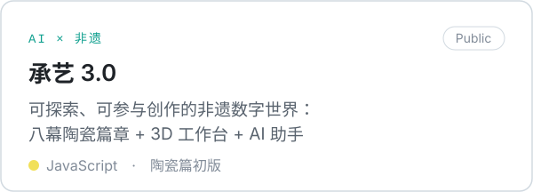
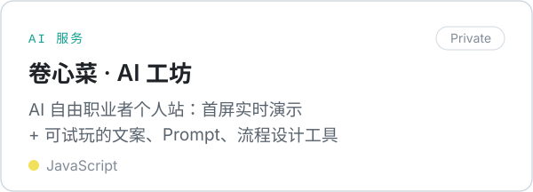

  <a href="https://github.com/ZeroOnehub/aipm-workbench"><picture><source media="(prefers-color-scheme: dark)" srcset="./assets/card-aipm-workbench-dark.svg" /></picture></a>
  <a href="https://github.com/ZeroOnehub/aipm-skills"><picture><source media="(prefers-color-scheme: dark)" srcset="./assets/card-aipm-skills-dark.svg" /></picture></a>

  <a href="https://zeroonehub.github.io/chengyi/"><picture><source media="(prefers-color-scheme: dark)" srcset="./assets/card-chengyi-dark.svg" /></picture></a>
  <a href="https://github.com/ZeroOnehub/chengyi-3"><picture><source media="(prefers-color-scheme: dark)" srcset="./assets/card-chengyi-3-dark.svg" /></picture></a>

  <a href="https://zeroonehub.github.io/bilibili-promo/"><picture><source media="(prefers-color-scheme: dark)" srcset="./assets/card-bilibili-promo-dark.svg" /></picture></a>
  <a href="https://github.com/ZeroOnehub/juanxincai-ai-site"><picture><source media="(prefers-color-scheme: dark)" srcset="./assets/card-juanxincai-ai-site-dark.svg" /></picture></a>

 

### 最近在研究 Now

> **DeepSeek Harness 插件架构**　Skill 加载只是开始，治理才是难题 
> **SKILL.md 工作流**　让 Agent 稳定调用，也把进度交还给人 
> **AI + 非遗数字化**　用 3D 和视频生成，让传统手艺可参与 
> 更新于 2026-10-19 · 每周更新

<!-- TODO(樊烨)：发布第一篇文章后加「### 文章 Writing」一节：- [标题](链接) 日期 -->

 

  <a href="https://github.com/ZeroOnehub">GitHub</a>
  <!-- TODO(樊烨)：确认后补上，用「 · 」分隔：个人网站 · 邮箱 · 小红书 · 公众号 · 人人都是产品经理 -->

