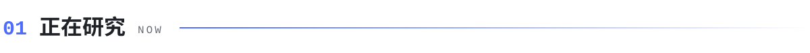
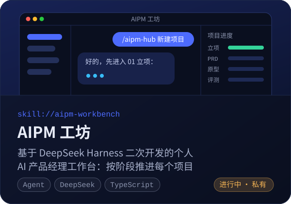
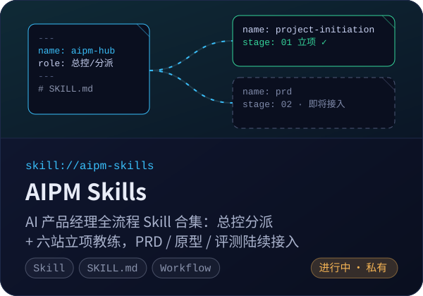
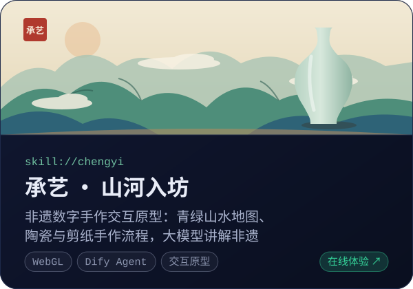

  

<!-- TODO(樊烨)：个人网站上线后，把头图链接到 https://zeroonehub.github.io -->

<picture>
  <source media="(prefers-color-scheme: dark)" srcset="./assets/sec-now-dark.svg" />
  
</picture>

<picture>
  <source media="(prefers-color-scheme: dark)" srcset="./assets/sec-projects-dark.svg" />
  
</picture>

  
  

  
  

  

  🏺 <a href="https://zeroonehub.github.io/chengyi/">承艺 在线体验</a> · <a href="https://github.com/ZeroOnehub/chengyi">源码</a>
  　｜　📺 <a href="https://zeroonehub.github.io/bilibili-promo/">B 站宣传页 在线预览</a> · <a href="https://github.com/ZeroOnehub/bilibili-promo">源码</a>
  　｜　🔒 AIPM 工坊 / Skills / 承艺 3.0 整理后公开

<!-- TODO(樊烨)：发布第一篇文章后，在这里加「✍️ 文章」一节：- [标题](链接) —— 日期 -->

<picture>
  <source media="(prefers-color-scheme: dark)" srcset="./assets/sec-contact-dark.svg" />
  
</picture>

  
  <!-- TODO(樊烨)：确认后取消注释并填写，每个链接都要亲自点开验证
  
  
  
  
  
  -->

<picture>
  <source media="(prefers-color-scheme: dark)" srcset="./assets/footer-dark.svg" />
  
</picture>
